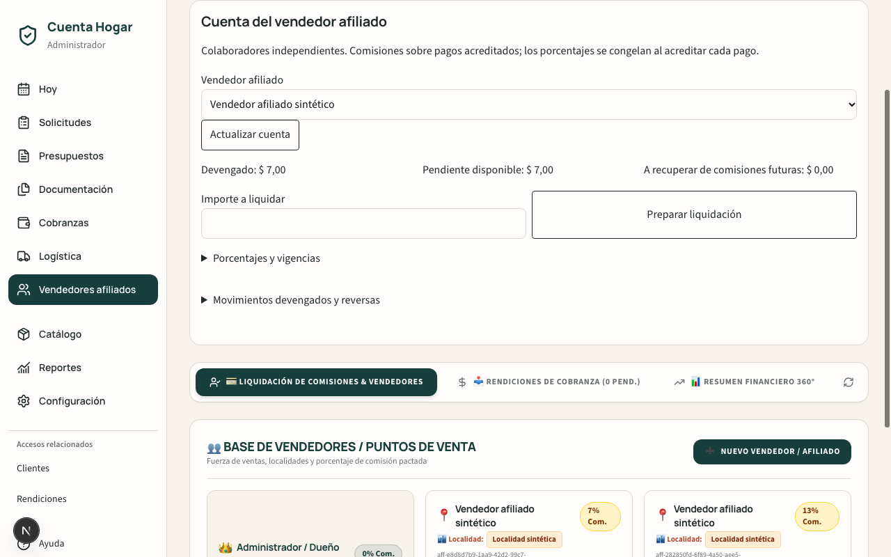
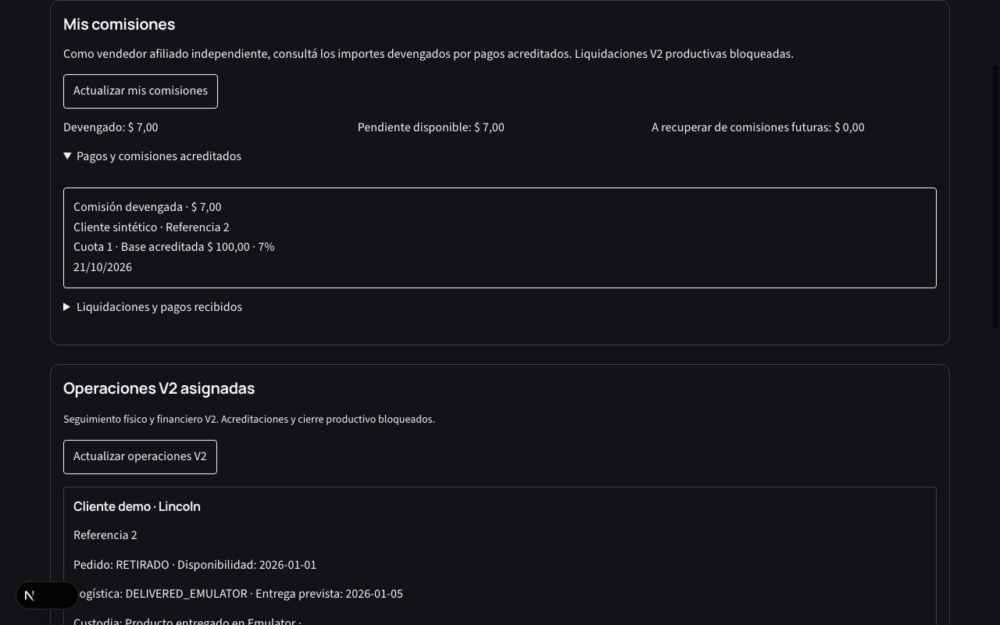
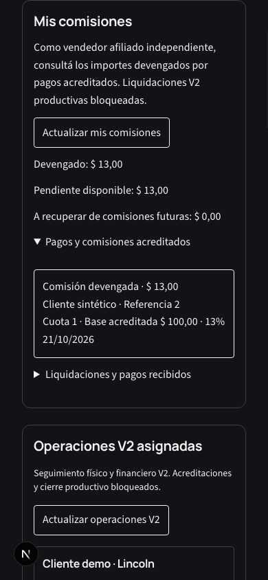
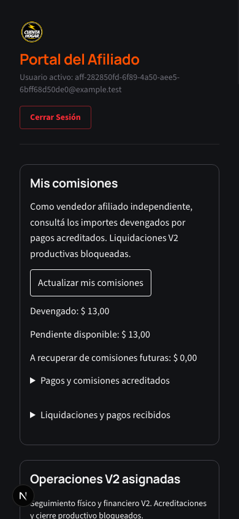

# Integración de vendedores afiliados y comisiones V2

Evolución de main `46f03c08f2e47ac219cb911bbb00bca2e0129563`. Los vendedores afiliados son colaboradores independientes. No se modifican Rules, IAM, secretos ni datos productivos.

## Decisiones comerciales aprobadas

- Base: importe efectivamente acreditado e imputado a cada cuota V2, no cuotas vencidas, promesas ni presupuesto nominal.
- Atribución `CURRENT_ASSIGNMENT_AT_CREDIT_V1`: afiliado asignado y porcentaje vigente al registrar la acreditación (fecha del servidor). La fecha efectiva bancaria no permite elegir un porcentaje histórico ni otro beneficiario.
- Cada imputación congela beneficiario, UID, configuración y porcentaje; las reasignaciones no trasladan devengamientos anteriores.
- Reversa de una comisión ya pagada: compensación automática con comisiones futuras. Se presenta un importe **a recuperar** separado y el disponible nunca es negativo. La liquidación existente conserva su evidencia de pago; no se reescribe.
- Se reutiliza el cálculo del motor existente: centavos enteros, porcentaje en puntos básicos y truncamiento de la fracción de centavo por imputación, sin cuotas ni economía alternativas.

## Persistencia y permisos

| Información | Ubicación | Escritura |
| --- | --- | --- |
| Registro único | `vendedores/{id}` | API administrativa; revisión esperada |
| Vigencias | `vendedores_configuraciones_comision/{id}` | Append-only, motor existente |
| Auditoría del registro | `vendedores/{id}/registryHistory/{commandId}` | Misma transacción |
| Resultado idempotente | `vendedores/{id}/registryCommands/{commandId}` | Digest de contenido y actor |
| Asignación | Subárbol de operación V2 existente | Comando de custodia; auditoría anterior/nuevo |
| Comisiones y reversas | `ledger_comisiones_movimientos/{id}` | Misma transacción que pago y recibo V2 |
| Liquidaciones y pagos | `liquidaciones_comision/{id}` e items existentes | Motor de liquidaciones existente |
| Llamados/promesas | Subcolección `engagements` de custodia V2 | UID activo y asignación vigente, comando idempotente |

No hay un segundo motor V2 de comisiones. Los movimientos llevan `operationSchemaVersion: OPERATION_COMMISSION_V2`, `operationId`, presupuesto/versión, pago, cuota, base, porcentaje, configuración y actor. Los identificadores se derivan de operación/pago/cuota; la reversa apunta al movimiento original. El perfil no puede cambiar un UID ya vinculado: recuperar una cuenta o sustituir una identidad requiere un procedimiento explícito independiente.

Una desactivación conserva perfil y registros. La lectura no crea vendedores ni configuraciones. El 0 % es válido y genera evidencia de base y porcentaje aunque el importe sea cero. Un porcentaje no configurado se muestra como pendiente, nunca como un porcentaje inventado.

## Integración administrativa y portal

- La Ficha Única conserva el control de custodia y enlaza Comisiones. Se permite reasignar tras la entrega exclusivamente en el circuito simulado sin reabrir movimientos físicos.
- `/admin/comisiones` incorpora cuenta, vigencias, disponible, recuperación, liquidaciones parciales/completas y pago por transferencia/efectivo. El registro permite editar datos, vincular UID, activar y desactivar.
- Lecturas históricas administrativas pasan por servidor. Un fallo parcial se presenta como advertencia, sin vaciar los resultados legítimos ni bloquear la página con un diálogo modal.
- `/afiliado` conserva operaciones, cuotas, vencimientos y recibos autorizados; añade comisiones propias, liquidaciones y gestiones por operación. Una promesa es sólo seguimiento comercial: no acredita pagos ni genera comisiones.
- Un afiliado reasignado pierde el expediente operativo. Conserva únicamente el acceso a sus movimientos legítimos de comisión; el nuevo afiliado no recibe los movimientos del anterior.

## Concurrencia e integridad

Pago, imputaciones, recibo, devengamientos y reversas son atómicos. Se leen asignación, configuración y movimientos antes de escribir. El replay financiero devuelve el resultado del comando sin nuevos movimientos. Una falla aborta toda la transacción.

La preparación de liquidación usa una transacción, una identidad determinista y conflicto si la misma clave pretende cambiar vendedor o importe. La confirmación vuelve a validar saldo, fuentes FIFO y reservas; el pago conserva las comprobaciones de efectivo y rendición. La recuperación posterior a una reversa reduce el disponible futuro sin generar pagos negativos.

## Bloqueos e históricos

Toda creación de movimientos de comisión por pagos V2 exige el mismo guard de Emulator que cobranza V2. Leer o liquidar movimientos V2 desde el motor compartido también exige ese guard. La pantalla nueva no permite liquidaciones productivas. No se habilitan numeración, congelamiento, emisión definitiva, FORMALIZED, entrega productiva ni cobranza real.

No hay migración automática, reatribución por email/DNI ni reconstrucción de comisiones históricas. Los presupuestos, Acceptance, snapshots y cronogramas no se modifican.

## Límites conocidos

Las vistas muestran hasta 50 movimientos/liquidaciones recientes y 30 gestiones. Los saldos usan el historial completo del motor existente, no esa muestra. La lectura histórica administrativa está acotada a 500 registros por sección y avisa si es parcial. Para volúmenes altos, el motor de comisiones compartido conserva consultas completas por vendedor; deberá medirse antes de habilitar liquidaciones productivas. No se añaden índices, migraciones ni automatismos productivos en este PR.

## Verificación

Los resultados y capturas de esta rama se registran en el informe del PR. Suites nuevas: `testAffiliateIntegrationV2Emulator.ts` y `runAffiliateIntegrationV2Browser.ts`. Todas las escrituras utilizan `demo-cuenta-hogar`, Auth/Firestore/Storage Emulator y personas sintéticas.

### Resultados ejecutados

| Gate | Resultado |
| --- | --- |
| TypeScript | PASS |
| Build | PASS |
| `npm run test:safe` | PASS |
| ESLint diferencial contra main | PASS: 83 errores base, 78 actuales, 0 nuevos, 5 resueltos |
| Integración de afiliados en Emulator | PASS |
| Finanzas V2 | PASS: FIFO, parciales/completos, recibos, reversas, concurrencia, integridad |
| Custodia V2 | PASS: asignación, roles, fotos privadas, históricos |
| Comisiones existentes | 15/15 PASS |
| Liquidaciones, caja y rendición existentes | 64/64 PASS |
| Navegador desktop/mobile | PASS: dos UID, reasignación, gestiones, desactivación, sin overflow |
| Escrituras / requests de prueba productivos | 0 |

ESLint completo no está limpio por deuda histórica; no se suprimieron reglas ni se eliminaron assertions. Se corrigió un bloqueo observado en el navegador: la pantalla antigua usaba consultas SDK dependientes del email de las Rules y un alert modal. Ahora las lecturas se autorizan por servidor y sus fallos se muestran en la página.

### Capturas sintéticas

