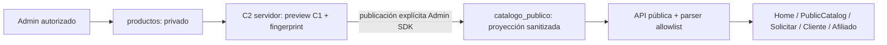

# Catálogo de referencias — cierre post-deploy de privacidad (C5B-3C)

## Estado y alcance del cierre

Base main confirmada tras fetch/pull: `bebe75907abf982e6bcbf65776831bf8e589e291`.
Proyecto: `negocio-facil-page`; backend App Hosting: `cuenta-hogar`, `us-central1`.
La verificación C5B-3C creó únicamente este documento. No cambió código, Rules,
configuración, DNS, motores, snapshots ni datos productivos; no ejecutó apply,
publish/unpublish, backfill, commit, push, PR ni deploy. El cierre documental
posterior autoriza únicamente commit y push en la rama docs/catalogo-privacy-closure,
sin merge ni deploy.

**La privacidad del catálogo queda aprobada y cerrada. La conciliación del inventario
queda pendiente:** el estado actual es 8 referencias privadas y 1 REVIEW_REQUIRED,
frente a las 7 privadas y 0 REVIEW_REQUIRED esperadas al iniciar la fase. La revisión
humana indicó: «No lo sé; dejar la discrepancia de inventario pendiente».
No se presume el origen, autor ni intención de publicación del registro adicional.
No se declara cerrado ese pendiente ni se corrige automáticamente. La referencia
REVIEW_REQUIRED permanece privada y no existe en catalogo_publico: no constituye
un fallo de privacidad ni bloquea su cierre. No debe modificarse ni eliminarse
como parte de este cierre.

PRIVACY_CLOSURE = COMPLETE
PUBLIC_PRODUCTS_EXPOSURE_FIXED = YES
INVENTORY_RECONCILIATION = PENDING

Los documentos históricos C0–C5A/C4 describen exposición transitoria anterior.
Este cierre registra el estado posterior al deploy C5B-3B, sin reescribirlos.

## Estado productivo reconfirmado

| Elemento | Evidencia actual |
| --- | --- |
| App build activo | `build-2026-10-19-001` |
| App SHA activo | `fb2735fda7ce1b3e2b8c1a4cd5f3211620ddc163` |
| Tráfico | 100%; build READY, rollout SUCCEEDED |
| Main del deploy de Rules | `bebe75907abf982e6bcbf65776831bf8e589e291` |
| Rules SHA-256 local y desplegado | `e5fff20af773ca68771d50b9f589ef4420b623dd01977d72d69d381e138f755b` |
| Ruleset desplegado | `883b9936-95e9-46b8-bc0a-8a0b52f0b0be` |
| Release | `projects/negocio-facil-page/releases/cloud.firestore` |

Se consultaron backend/tráfico y release/source de Rules mediante GET. No se creó
otro rollout ni se volvió a desplegar Rules. La fuente desplegada coincide en hash
exacto con el archivo versionado aprobado; no se infiere el App SHA desde main.

## Recorrido C1–C5

| Fase | Resultado que se conserva |
| --- | --- |
| C1 — contratos y cálculo puro | Contratos privado/público, factores por plazo 1–18, validación y mapper por allowlist; importes de referencia en ARS. Sólo planes explícitamente activos. NEXT_90_V1 conserva miles enteros exactos; en los demás casos busca la siguiente terminación 90 sin bajar la base. No sustituye CANONICAL_V1 ni MANUAL_FACTOR_V1 ni crea deuda/contratos. |
| C2 — publicación explícita | Preview sanitizada y fingerprint del contenido público; comandos autenticados Admin, ID estable y transacción con relectura. Publicación idempotente por full replace; guardado privado no publica. Despublicación explícita conserva privado. |
| C3 — Admin | `/admin/productos`, seis secciones, separación Sólo Administración, planes, imágenes y preview pública. Stock/unidades y compatibilidad legacy conservados. Los cambios privados requieren publicación explícita; stock no condiciona la publicación. |
| C4 — consumidores | HomeTechCatalog, PublicCatalog, Solicitar, Cliente y Vendedor afiliado consumen DTO público por HTTP; no leen ni escriben productos, no importan catalogManager y no recalculan pricing del catálogo en cliente. |
| C5A/C5B-1 — inventario | Clasificación, paridad y dry-run; vía productiva separada de sólo lectura y dos colecciones permitidas. Ninguna anomalía se publica automáticamente. |
| C5B-2 — publicación controlada | Seis creaciones manualmente aprobadas mediante C2, sin modificar privados/flags/históricos; horno excluido. El backfill autorizado ya ocurrió y no se repite en esta fase. |
| Pre-C5B3/C5B-3A | App compatible desplegada al 100%; Rules exactas probadas en Emulator, regresión de otras colecciones, Admin C3 y consumidores C4; A/B y smoke final 12/12 sin cambiar runner/assertions. |
| C5B-3B/C5B-3C | Deploy exclusivo de Rules exitoso; denegación privada con Client SDK anónimo real, catálogo público y Admin operativos. Este documento consolida evidencias y registra la discrepancia privada actual. |

## Arquitectura final



C2 verifica autorización Admin en endpoints; Admin SDK bypassa Rules y no convierte
la API en escritura pública. No hay trigger, dual write ni sincronización automática
al guardar. La identidad es `productos/{id}` ↔ `catalogo_publico/{id}`.

El DTO tiene únicamente `referenciaId`, `nombre`, `descripcion`, `imagenUrls`,
`planesPublicados` (cuotas y cuotaEstimada), `publicado` y `schemaVersion`.
El parser vuelve a construir la allowlist, incluidos planes anidados. Las APIs
`GET /api/catalogo` y `GET /api/catalogo/[id]` leen sólo catalogo_publico; no hay
fallback ni enriquecimiento desde productos si una referencia pública no existe.
Los importes publicados son orientativos para gestión de compra por mandato.
No acreditan stock, reserva, disponibilidad de proveedor ni una propuesta aceptada.

## Rules finales y matriz de permisos

```text
match /productos/{document=**} {
  allow read, write: if isAdmin();
}
match /catalogo_publico/{referenceId} {
  allow read: if isAdmin() || resource.data.publicado == true;
  allow write: if false;
}
match /{collection}/{document=**} {
  allow read, write: if collection != "catalogo_publico" && isAdmin();
}
```

Los grants son aditivos: excluir catalogo_publico del catchall impide que éste
reabra escrituras Admin browser o conceda permisos a sus subcolecciones.
Los otros bloques de Rules conservan sus condiciones.

| Operación Client/browser | Anónimo | Cliente | Vendedor afiliado | Admin |
| --- | --- | --- | --- | --- |
| productos documento/listado/query/subcolecciones | DENY | DENY | DENY | ALLOW |
| productos escritura | DENY | DENY | DENY | ALLOW |
| catálogo publicado lectura/query publicado==true | ALLOW | ALLOW | ALLOW | ALLOW |
| catálogo oculto lectura | DENY | DENY | DENY | ALLOW |
| catálogo query amplia sin filtro | DENY | DENY | DENY | ALLOW |
| catálogo create/update/delete | DENY | DENY | DENY | DENY |
| catálogo subcolecciones lectura/escritura | DENY | DENY | DENY | DENY |

La matriz de cuatro roles fue probada en Emulator C5B-3A y su hash se reconfirmó
contra producción. En C5B-3C se repitieron sólo las lecturas anónimas productivas,
sin login. No se afirman nuevas pruebas autenticadas de Cliente/Afiliado ni nuevas
pruebas productivas de escritura. Admin SDK se usa únicamente para inventario:
su lectura NO se presenta como evidencia de denegación por Rules.

## Inventario productivo actual y discrepancia pendiente

Dos lecturas completas de productos/catalogo_publico, estables:
2026-10-19T01:46:29.449Z–01:46:30.245Z y
2026-10-19T01:46:30.265Z–01:46:30.597Z (UTC).
Se reutilizó `catalogProductionInventoryReadOnly.ts`, con proyecto explícito,
credencial local existente, hosts Emulator ausentes y salida protegida 0600 fuera de Git.
Su adaptador expone sólo get() de esas dos colecciones. No leyó otras colecciones
ni ejecutó herramientas de apply.

| Métrica | C5B-2/post-deploy acreditado | Lectura actual C5B-3C |
| --- | ---: | ---: |
| PRIVATE_REFERENCES | 7 | **8** |
| PUBLIC_REFERENCES | 6 | 6 |
| ALREADY_CURRENT | 6 | 6 |
| NOT_ELIGIBLE | 1 | 1 |
| REVIEW_REQUIRED | 0 | **1** |
| READY_NEW / READY_UPDATE | 0 / 0 | 0 / 0 |
| INVALID_PRIVATE | 0 | 0 |
| PUBLIC_ORPHAN | 0 | 0 |
| PUBLIC_MALFORMED | 0 | 0 |
| IDENTITY_CONFLICT | 0 | 0 |
| Paridad pública current/outdated/invalid | 6 / 0 / 0 | 6 / 0 / 0 |

La fila adicional es exclusivamente privada: `publicExists=false`, sin evidencia
de publicación, flags legacy ausentes y motivo
`ACTIVE_LEGACY_PLAN_OUTSIDE_1_18`. No se incluyen su ID, nombre ni valores privados.
Se conserva REVIEW_REQUIRED; no se normalizan planes, no se crean flags, no se
reclasifica ni se publica. Su conciliación requiere revisión separada. No hay
indicios de exposición pública de esa fila; la discrepancia no reabre la Rule de
productos ni altera las seis proyecciones actuales.

Las seis referencias públicas aprobadas se mantienen idénticas al plan C5B-2:

| referenciaId público | Planes publicados |
| --- | --- |
| `313uufET7xOR1kXyPAG6` | 12 |
| `5qYNJkPGWm4gGgISjH56` | 12 |
| `D6bStUjs0j5D5wknli8i` | 8, 12 |
| `tXshmaQnIatZzM2ND8IS` | 8, 12 |
| `tYuknm6Alau0GY8Ip6wD` | 8, 12 |
| `yPGtIX7i601rZdJtPLVo` | 12 |

HORNO ELECTRICO: NOT_ELIGIBLE por EXPLICIT_LEGACY_DISABLE; PUBLICADO=NO.
La octava referencia privada no sustituye ni se incorpora a esta allowlist.

## Evidencia post-deploy y límites

| Evidencia | Resultado / procedencia |
| --- | --- |
| Deploy C5B-3B | `npx firebase-tools deploy --only firestore:rules --project negocio-facil-page`: SUCCESS, CLI 15.34.0; no se repitió en C5B-3C. |
| Producto privado anónimo | DENY, error permission-denied; Firebase Client SDK sin autenticación, reconfirmado C5B-3C. Nunca se imprime documento privado. |
| Referencia pública anónima | ALLOW; existe, publicado=true, schemaVersion=1; reconfirmado C5B-3C. |
| Query pública publicado==true | ALLOW, exactamente los seis IDs aprobados; reconfirmado C5B-3C. |
| API pública | HTTP 200, seis DTO válidos, fingerprints/planes coincidentes con C5B-2; cero claves sensibles en listado y seis detalles, reconfirmado C5B-3C. |
| Admin privado | ALLOW; siete fichas visibles acreditadas en C5B-3B. Es un conteo histórico, no el actual: el inventario presente lee ocho privados. No se reabrió Admin en C5B-3C. |
| Modal stock | PASS read-only acreditado C5B-3B, estado vacío legible sin permission-denied. Sin altas, bajas, movimientos ni guardados; no se repitió la navegación en esta fase. |
| Red pública | C4 browser acreditó cero campos sensibles y cero requests productos. Después del deploy, recursos de Home, PublicCatalog y Solicitar observaron API pública y cero Firestore/productos. No se repite browser en C5B-3C. |
| Gates de Rules | C5B_RULES_TESTS PASS; GENERAL_RULES_TESTS 36/36; Admin C3 PASS; consumidores C4 PASS; smoke final 12/12. Evidencia C5B-3A/A/B sin cambiar código ni assertions. |

PUBLIC_API_SENSITIVE_FIELD_LEAKS = 0 (lectura actual)
NETWORK_SENSITIVE_FIELD_LEAKS = 0 (evidencia browser acreditada de superficies públicas)
BROWSER_PRODUCTS_REQUESTS = 0 (evidencia browser acreditada)
ADMIN_PRIVATE_PRODUCTS_READ = ALLOW (evidencia post-deploy acreditada)
ADMIN_STOCK_MODAL_READ_ONLY_CHECK = PASS (evidencia post-deploy acreditada)

Lista de claves prohibidas auditadas recursivamente: sku, skuInterno, ean,
codigoBarras, codigoProducto, costo, costoProducto, costoProveedor, proveedor,
factor, factoresPlanes, precioContado, precioAnterior, tna, tasaInteresTna,
tasaMora, mora, margen y stock. La revisión de claves no sustituye la revisión
editorial de textos e imágenes ni recupera información descargada antes del cierre.
No se incluyen documentos raw, credenciales, costos, proveedores, códigos o series
productivos en este documento ni en Git.

## Consumidores y deuda separada

La auditoría AST actual (`auditCatalogPrivacyConsumers.ts`) pasó con 59 referencias
clasificadas, cero consumidores desconocidos y cero imports de catalogManager.
Se contrastó con búsqueda de accesos/imports en HomeTechCatalog, PublicCatalog,
/solicitar, /cliente y /afiliado, más el reader/cliente HTTP compartidos.
Las escrituras de formularios de solicitudes existentes no son escrituras de
productos; no se ejecutaron en esta fase.

NON_ADMIN_DIRECT_PRODUCTS_READS = 0
NON_ADMIN_DIRECT_PRODUCTS_WRITES = 0
LEGACY_PRODUCTS_FALLBACK = NO

PREEXISTING_PERMISSION_DEFECT = YES
CATALOG_PRIVACY_DEPENDS_ON_THIS_FIX = NO

/cliente consulta solicitudes por clienteId; /afiliado por afiliadoEmail. Ese defecto
no se corrige ni se equipara a un problema del catálogo. La carga pública de catálogo
permanece separada. La intermitencia previa browser/CDP/logout quedó documentada
con A/B (tres base y tres target 12/12) y una única corrida final 12/12; el logout no
espera Firestore. No se aisló su causa técnica exacta ni se cambió código por ella.

C6_CLEANUP_CANDIDATES:

| Candidato | Tratamiento futuro; ninguna limpieza ejecutada |
| --- | --- |
| catalogManager.ts sin uso | Evaluar retiro tras mantener auditoría de imports/callers en cero. No ejecutar ni trasladar su cálculo legacy. |
| cuota8/cuota12 | Mapear escritores/consumidores de compatibilidad antes de retirar; no son fuente pública vigente. |
| precioContado | Auditar semánticas históricas y snapshots; no sustituirlo por costo ni por una cuota calculada. |
| codigoProducto | Conservar trazabilidad legacy; no reinterpretarlo automáticamente como SKU/EAN. |
| flags activo/publicado | Revisar compatibilidad y elegibilidad; no inferir publicación ni sobrescribirlos. La proyección C2 es autoridad pública vigente. |
| compatibilidad de snapshots | Preservar source, pricingMode, importes/condiciones guardadas, presupuestos/PDF y vínculos históricos; no recalcularlos desde el catálogo vivo. |

Estos candidatos no bloquean el cierre técnico de privacidad ni autorizan borrado.
La discrepancia de inventario REVIEW_REQUIRED se mantiene como pendiente distinto,
sin asumir que sea un candidato de eliminación C6.

## Rollback seguro y DNS

ROLLBACK_REOPENS_PRODUCTS = NO. Nunca restaurar productos `allow read: if true`.
Ante problema de aplicación, mantener productos privado y reparar API/consumidores;
conservar catalogo_publico sanitizado. Ante defecto específico de Rules, preparar
una corrección igualmente privada con autorización separada. No restaurar campos
sensibles al público ni modificar snapshots/IDs como parte del rollback.

www.cuentahogar.com.ar = ACTIVE / HTTP 200, reconfirmado por GET.
cuentahogar.com.ar = pendiente (ENOTFOUND en HTTP; diagnóstico DNS previo
NOERROR/NODATA, sin registros de dirección; zona Cloudflare).
ROOT_DOMAIN_FIX_DEFERRED = YES. No se cambia DNS ni App Hosting en este cierre.

## Evidencia local y control final

Evidencia C5B-3C fuera de Git: `/tmp/cuenta-hogar-c5b3c-closure/`:
production-inventory.json (dos lecturas estables), deployed-rules.json,
anonymous-client-results.json, public-api-verification.json, app-status.json,
consumer-audit.json y logs protegidos. Evidencia post-deploy previa:
`/tmp/cuenta-hogar-post-rules/verification-summary.json` y sus capturas seguras;
A/B: `/tmp/cuenta-hogar-c5b3-ab-5nsrf2kj/`.
Los artefactos locales no sustituyen la descripción versionada ni se incorporan a Git.

Código/Rules sin cambios: comparación de todos los archivos tracked contra snapshot
previo a este documento. Sólo se crea docs/CATALOGO_REFERENCIAS_PRIVACY_CLOSURE.md.
Quality gate documental: git diff --check y revisión de whitespace del archivo nuevo.
No se repiten TypeScript, build, emuladores ni browser por este cambio documental.

Registro de la verificación C5B-3C, anterior al commit/push documental:

CODE_CHANGED = NO
RULES_CHANGED = NO
PRODUCTION_DATABASE_MUTATIONS = 0
COMMITS_CREATED = 0
PUSH_EXECUTED = NO
PR_CREATED = NO
DEPLOY_EXECUTED = NO

PRIVACY_CLOSURE = COMPLETE. Cierre formal de privacidad aprobado;
INVENTORY_RECONCILIATION = PENDING. El pendiente de inventario no es un fallo de
privacidad. No se aprueba modificar, eliminar ni publicar la referencia adicional.
