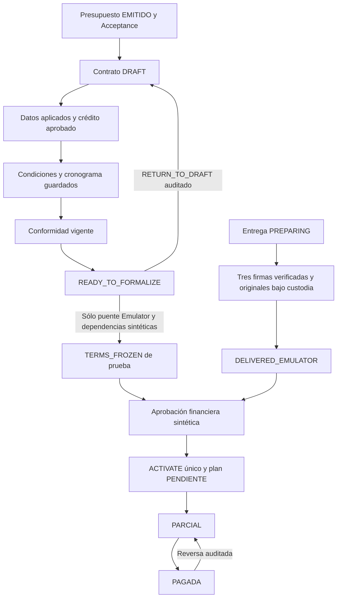

# Validación de contrato entrega y cuotas V2

El circuito sintético de doce cuotas completa edición, revisión READY, documentación, entrega y seguimiento financiero por Administración, vendedor afiliado y cliente en Firebase Emulator. Se corrigió una incompatibilidad del snapshot de prueba que impedía avanzar cuando el borrador contenía cantidad y condición del producto. La habilitación productiva y la aprobación jurídica siguen pendientes.

Base: `24143f6f168a76dadb51e95b260a8731fd7b294f`, main verificado el 22/10/2026. Proyecto exclusivo `demo-cuenta-hogar`: Next localhost:3000, Auth 127.0.0.1:9099, Firestore 127.0.0.1:8080 y Storage 127.0.0.1:9199. Sin accesos a Firebase productivo, credenciales productivas, migraciones, cambios de Rules ni despliegues.

## Estados implementados



Documentación, entrega y finanzas son estados separados. READY no acredita firmas; el evento de entrega tampoco habilita por sí solo las cuotas. `FORMALIZED` no se utiliza en este recorrido. El cliente tiene vínculo UID explícito `PREPARED` → `ACTIVE` por invitación de Emulator; el afiliado requiere asignación vigente y perfil activo.

## Implementación y límites comprobados

| Módulo | Implementado y probado | Pendiente para uso real |
| --- | --- | --- |
| Contrato | Comandos con commandId, CAS por revisión, auditoría, conformidad y retorno explícito a borrador (`contractV2Server.ts`, `contractReadyV2.ts`) | Aprobación jurídica y emisión definitiva |
| PDF de operación | Proyección guardada común de mandato/pagaré (`contractDocuments/operationDraft*.ts`); sin número definitivo | Instrumentos aprobados, representación y lugares efectivos |
| Snapshot | Congelamiento técnico aislado (`contractFreezeIntegrationEmulator.ts`) | No hay ruta productiva habilitada |
| Entrega | Tres firmas, evidencia privada, originales y custodia (`operationDeliveryV2Server.ts`) | Cierre productivo bloqueado |
| Finanzas | FIFO, cuotas, pagos, reversas, recibos y autorización (`operationFinancialV2Server.ts`) | Activación y cobranza productivas bloqueadas |
| Afiliado | Asignación por UID, exclusión de otro vendedor y de inactivos (`operationCustodyV2Server.ts`) | Sin facultad para acreditar o revertir pagos |
| Cliente | Vínculo activo y cuenta verificada (`operationClientV2Server.ts`) | Invitaciones productivas bloqueadas; falta un comando para revocar un vínculo ya ACTIVE |

La revocación de invitaciones PENDING ya existe. La prueba de acceso revocado utiliza una fixture con vínculo PREPARED, y las suites cubren también cuenta Auth deshabilitada. Eso demuestra la denegación del servidor, pero no constituye una función administrativa para desactivar un servicio ya vinculado.

## Matriz de resultados

| Etapa o caso negativo | Resultado | Evidencia |
| --- | --- | --- |
| Consulta, persistencia única, presupuesto y Acceptance concurrente | PASS | `journey.json`, etapas 01–03 |
| Datos personales/laborales, aplicación explícita, producto cantidad 1 NUEVO | PASS | Etapas 04, 07C y PDF actuales |
| Plan 12 → 8 → 12, conformidad invalidada y renovada | PASS | Etapa 06; no cambia presupuesto emitido |
| Retorno READY → DRAFT → READY y auditoría | PASS | Etapa 07C y suite READY |
| Revisión optimista, doble envío, reintentos y cambios concurrentes | PASS | Suites ContractV2, producto y READY |
| PDF actual y datos persistidos de la misma revisión | PASS | `qa.json`: misma identidad y revisión 14 |
| Reutilización documental y evaluación independiente del recurrente | PASS | Etapas 07 y 07B |
| Firma faltante de mandato, pagaré o remito bloquea entrega y finanzas | PASS | `extra-controls.json`, seis casos separados |
| Firma/hash inconsistente, original de otra versión, falta de entrega o custodia | PASS | Controles adicionales y suite Delivery |
| Daño/rechazo, custodia y devolución | PASS | Suite Delivery; no equivale a entrega |
| Tres firmas y originales correctos permiten entrega sólo Emulator | PASS | Etapa 11 y suite Delivery |
| Activación única, replay y segundo ACTIVATE incompatible | PASS | Controles adicionales; una proyección financiera |
| Doce cuotas idénticas al snapshot y al PDF actual | PASS | Comparación fila por fila en `qa.json` |
| Pago parcial, completo, cancelación y reversa | PASS | Etapas 13, 13B y suite Financial |
| Duplicados, rollback transaccional, FIFO, mora sin recargos y recibos | PASS | Suite Financial |
| Afiliado A autorizado, B denegado y A desactivado sin acceso | PASS | Controles adicionales |
| Afiliado no acredita ni revierte, tampoco por API administrativa | PASS | HTTP 403 en ambos comandos |
| Cliente titular, sin vínculo activo, cruzado o cuenta deshabilitada | PASS | Controles adicionales y suite Client |
| Administración, afiliado y cliente ven el mismo saldo y cronograma | PASS | Comparación de respuestas y capturas de tres roles |
| Históricos, digests y updateTime de sentinelas inalterados | PASS | Etapa 16, suites de producto y finanzas |
| Guardas de congelamiento, entrega, invitaciones y cobros productivos | PASS | Suites de modelo, guardas y pruebas negativas |
| Navegación desktop 1280 y mobile 390 sin overflow horizontal | PASS | 19 puntos de captura/UX, incluyendo ambos portales |

Son **20 etapas del recorrido y 21 controles adicionales**, además de las suites de regresión. No se presenta ese número como cantidad total de assertions.

## Economía y pagos sintéticos

Capital $580.000, servicios $1.160.000, total $1.740.000. Doce cuotas de $145.000, primera el 15/12/2026, día habitual 30; febrero se ajusta al 28/02/2027. Última cuota 30/11/2027. Las doce fechas e importes se comparan entre proyección, snapshot y ledger; el PDF se contrasta por texto nativo, fila por fila. No hay cálculos económicos en el generador PDF.

| Movimiento de la misma operación | Acreditado neto | Saldo |
| --- | --- | --- |
| Activación | $0 | $1.740.000 |
| Pago parcial de $72.500 | $72.500 | $1.667.500 |
| Segundo pago de $72.500 | $145.000 | $1.595.000 |
| Pago de cancelación de $1.595.000 | $1.740.000 | $0 |
| Reversa de la cancelación | $145.000 | $1.595.000 |

Quedan tres recibos, uno REVERSADO y dos ACREDITADOS; cuota 1 PAGADA y once PENDIENTES. Las comisiones se registran en su ledger separado, sin generar una segunda deuda del cliente. Se verifica mora con fecha sintética futura y cero recargos. El cronograma original permanece idéntico después de los movimientos.

## Defectos y correcciones

1. **Defecto real del puente Emulator:** `reviewedTerms()` incluye `productDetails`, pero el snapshot no los conservaba ni reconstruía en el hash READY. Reproducido con cantidad 1 y condición NEW: `CONTRACT_READY_TERMS_MISMATCH`. Se preserva ese campo y se valida su digest; no se omite para hacer pasar la prueba.
2. **Fixture integral desactualizada:** creaba al afiliado sin porcentaje vigente; el primer pago devolvía 403 por configuración de comisión ausente. Se mantiene el rechazo y se verifica que no genera pago ni cambia revisión; luego se crea una configuración exclusivamente sintética.
3. **Arranque del navegador de pruebas:** el plazo anterior no alcanzó en un arranque frío y dejaba Chrome abierto al fallar. El helper espera hasta 300 intentos locales y cierra su propio navegador si falla; conserva la assertion del target y no toca sesiones reales.
4. **Aislamiento entre suites:** ejecutar todas sobre la misma instancia provocaba colisión del correo de fixture y del inventario global de snapshots. Las suites que requieren vacío se ejecutan con una instancia nueva cada una; no se eliminan sus assertions ni se limpian datos productivos.

5. **Scanner estático anterior con falso positivo:** confundía la propiedad de bloqueo `solData.contractSnapshotV2` de un endpoint histórico con una importación de infraestructura técnica. Ahora analiza imports, reexports, import dinámico y require mediante el AST de TypeScript; permite validadores puros y sigue rechazando los escritores exclusivos de Emulator. Se agregan casos positivos y negativos del scanner. No se modifica el endpoint ni se elimina la comprobación de aislamiento.

## Compatibilidad del campo de snapshot

`ContractSnapshotV2.productDetails` es opcional: `{ quantity: number | null, condition: 'NEW' | 'USED' | null }`, con el validador existente de cantidades y condición. Sólo se admite si el snapshot declara revisión técnica con `executionMode: EMULATOR_ONLY`. Su único escritor nuevo es el adaptador Emulator. El validador compartido lo incluye al reconstruir READY y en la integridad canónica.

No se agrega el campo a snapshots viejos, no se recalculan hashes persistidos y no hay migración. Se conservan schemaVersion y snapshotVersion porque el campo es opcional, restringido a la variante técnica ya discriminada y compatible con la ausencia histórica. Se rechaza alterarlo, quitarlo cuando forma parte de READY, agregar cantidades inválidas o incorporarlo a la variante histórica de fixture. Los consumidores financieros conservan el mismo total y cronograma. No se habilita una ruta de creación productiva.

## Documentos y evidencias

Los PDF entregados son los borradores actuales previos al congelamiento sintético, ambos de la revisión 14: mandato de tres páginas con logo oficial y pagaré de una sin logo. Mantienen datos societarios, total exacto, texto seleccionable y advertencia de borrador. No tienen numeración definitiva. El CH-000001 que aparece en el ledger pertenece exclusivamente al contador demo.

El remito adjunto es un comprobante técnico inequívocamente sintético para ejercitar la evidencia; no es una maqueta aprobada para entrega real. Las imágenes de firmas indican que son pruebas; no representan firmas físicas auténticas ni aprobación profesional.

El archivo técnico Emulator también ejercita sus plantillas históricas de referencia, separadas de las vistas previas actuales. Esas referencias conservan cláusulas antiguas y parámetros pendientes; no se usan como texto aprobado ni se modifican en este PR. La fixture financiera autoriza explícitamente hashes de los documentos preparados, nunca una aprobación jurídica real.

[Mandato de operación](evidence/contract-delivery-financial/mandato-borrador-operacion.pdf) · [Pagaré de operación](evidence/contract-delivery-financial/pagare-borrador-operacion.pdf) · [Remito técnico](evidence/contract-delivery-financial/remito-sintetico.pdf).

[Comparación de datos y PDFs](evidence/contract-delivery-financial/qa.json) · [Recorrido HTTP y UX](evidence/contract-delivery-financial/journey.json) · [Controles de permisos y activación](evidence/contract-delivery-financial/extra-controls.json).

| Perfil | Desktop | Mobile |
| --- | --- | --- |
| Administración | [Captura](evidence/contract-delivery-financial/final-finanzas-1280.png) | [Captura](evidence/contract-delivery-financial/final-finanzas-390.png) |
| Vendedor afiliado | [Captura](evidence/contract-delivery-financial/10-portal-afiliado.png) | [Captura](evidence/contract-delivery-financial/10-portal-afiliado-mobile.png) |
| Cliente | [Captura](evidence/contract-delivery-financial/11-portal-cliente.png) | [Captura](evidence/contract-delivery-financial/11-portal-cliente-mobile.png) |

## Próximas correcciones y habilitación real

- **P1 antes de clientes reales:** resolver revisión jurídica, representación y plantillas definitivas; diseñar las habilitaciones productivas como tareas separadas con autorización. Los puentes `EMULATOR_FREEZE_DEPENDENCIES`, `CLIENT_ACTIVATION_FIXTURE` y `FINANCIAL_APPROVAL_FIXTURE` no se trasladan a producción.
- **P1 de control de acceso futuro:** definir y agregar revocación administrativa auditada de vínculos ACTIVE, sin depender de una edición directa de Firestore. Hoy ese procedimiento no existe; no se amplían permisos aquí.
- **P2 de UX:** presentar fechas en formato local; relegar códigos y recibos técnicos a detalles; compactar las doce tarjetas y priorizar saldo y próxima cuota. En mobile no hay overflow, pero la lista requiere bastante desplazamiento. El aviso demo permanece visible por seguridad.
- **P2 editorial ya conocido:** el pagaré actual conserva un doble punto tras S.R.L.; la propuesta documental de Etapa 2A lo corrige sólo para revisión. Este PR no cambia cláusulas ni plantillas.

No se encontraron otros bloqueos funcionales en el recorrido corregido dentro de Emulator. Esto no valida jurídicamente los documentos ni habilita emisión, FORMALIZED, cierre de entrega, invitaciones o cobranza con clientes reales.

## Comandos y resultados

**PASS:** TypeScript, ESLint diferencial (cero diagnósticos), build, test:safe, modelos de infraestructura/congelamiento y regresiones de PDF. **PASS:** nueve suites Emulator, ejecutadas en instancias independientes sobre el árbol corregido. Las pruebas Emulator se corrieron por separado, sin importaciones ni exportaciones de datos.

```sh
# Con proyecto demo, hosts locales y variables sintéticas del runner configurados:
npx tsc --noEmit
npx eslint src/lib/contractSnapshotV2.ts src/lib/contractFreezeIntegrationEmulator.ts scripts/testContractFreezeIntegration.ts scripts/testV2IntegralJourney.ts scripts/helpers/catalogBrowser.ts scripts/testContractDeliveryFinancialControls.ts
npm run build
npm run test:safe
npx tsx scripts/testContractFreezeIntegration.ts
npx tsx scripts/testContractInfrastructure.ts
npx tsx scripts/testOperationDraftDocuments.ts
npx tsx scripts/testContractDocuments.ts
# Ejecutar cada suite en emuladores nuevos; nunca sobre un proyecto real.
npx firebase-tools emulators:exec --project demo-cuenta-hogar --config firebase.test-release.json --only auth,firestore,storage 'npx tsx scripts/testV2IntegralJourney.ts'
```

Repetir el último comando por separado con `testContractDeliveryFinancialControls`, `testOperationDeliveryV2Emulator`, `testOperationFinancialV2Emulator`, `testContractProductPreparationEmulator`, `testContractReadyEmulator`, `testContractV2Emulator`, `testOperationClientV2Emulator` y `testContractFreezeIntegrationEmulator` (todos `.ts` dentro de `scripts/`). Auth/Firestore/Storage deben tener los hosts indicados al comienzo; configurar el correo de administrador sintético del helper y el HMAC exclusivamente de prueba. El runner integral inicia Next local y un Chrome con perfil temporal propio. No utilizar credenciales ADC ni secretos reales.
