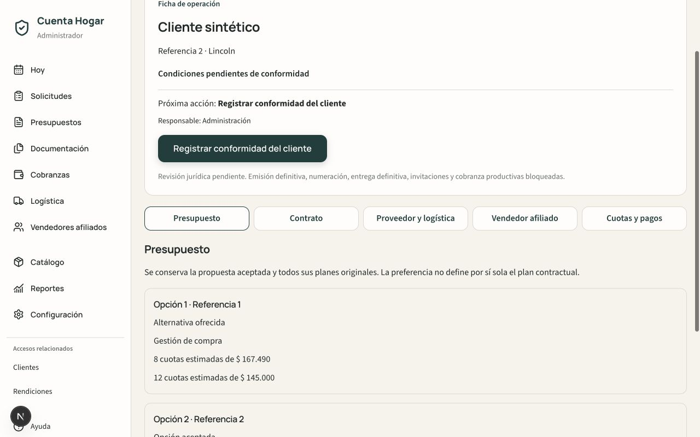
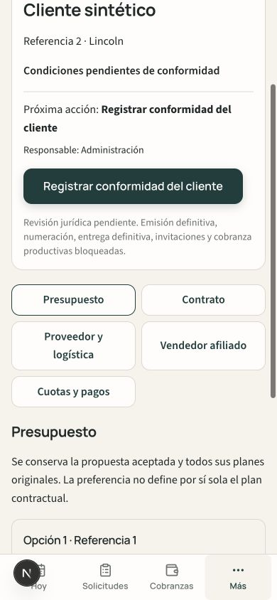
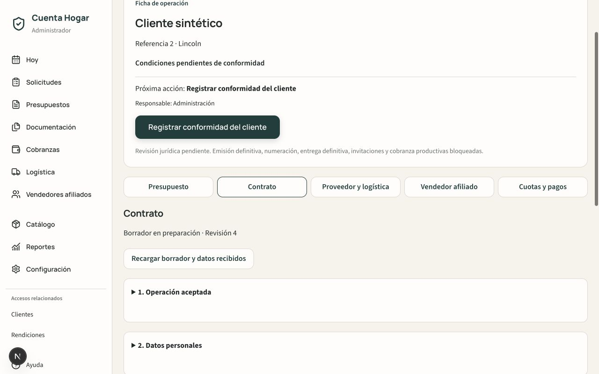
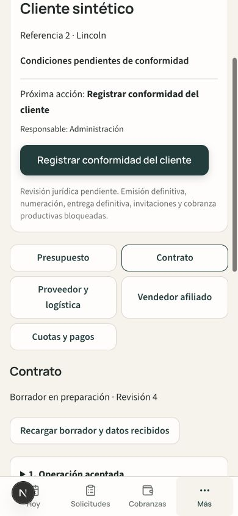

# Ficha única de operación V2

Baseline: `6f7aff2ee4862d581d7b40a4ddd2745e1dd6ccac`.

La aceptación registrada enlaza a `/admin/operaciones/{budgetId}/{version}`.
La ficha consulta el endpoint contractual administrativo existente y reutiliza
su identidad `operationId`. No crea expedientes al abrirse. Preparar el borrador
requiere una acción explícita. No existe nueva colección raíz ni un segundo
estado general persistido: la próxima acción es una proyección de presentación.

## Secciones y componentes reutilizados

- Presupuesto: versión original, alternativas y opción aceptada; origen servido
  por `getContract` tras validar Budget/Acceptance. Sólo para Administración.
- Contrato: `ContractV2Composer`, datos personales/laborales, revisión explícita,
  enlace seguro y `ContractDocumentWorkspace`. Pasos desplegables; las diferencias
  recibidas se muestran sin repetir campos idénticos. La auditoría es secundaria.
- Proveedor y logística: `OperationFulfillmentWorkspace` y
  `OperationDeliveryWorkspace`; costos y fechas permanecen en sus modelos.
- Vendedor afiliado: `OperationCustodyWorkspace`, asignación y custodia vigentes.
- Cuotas y pagos: `OperationFinancialWorkspace`, con `OperationClientWorkspace`
  en un acceso secundario. La habilitación sigue dependiendo del servidor.

La cabecera muestra cliente, producto, localidad, estado comprensible, responsable
administrativo y próxima acción. Las incidencias abiertas tienen prioridad.
Los IDs se conservan en la referencia técnica desplegable. Consultar o cambiar
sección no ejecuta comandos operativos.

## Datos del cliente y compatibilidad

Los nuevos requests contractuales agregan `dataScope: PERSONAL_EMPLOYMENT_ONLY`.
Sus submissions aceptan exclusivamente datos personales y laborales. El formulario
público no ofrece plan, importes ni día de vencimiento. Los campos de esquema
`preferredMonthlyDueDay` de submissions pasan a ser opcionales para estos envíos;
los registros históricos con ese campo conservan su lectura, digest y aplicación
administrativa explícita. No se reescribe ningún request o submission al leerlo.
La aplicación de un envío nuevo conserva condiciones económicas y fechas.
No cambian las respuestas públicas de bootstrap ni se exponen datos económicos.

## Nueva conformidad sobre condiciones modificadas

Se reutilizan `contractEconomics` y `contractSchedule`; no cambia ningún motor.
Cuando un comando administrativo cambia condiciones o cronograma, la transacción
invalida la conformidad vigente. La evidencia se conserva privadamente en:

`presupuestos_v2/{budgetId}/contracts/v{version}/conformity/current`

Contiene hashes de condiciones, actor y fecha del cambio; después de registrar
conformidad contiene hash confirmado, fecha, actor y referencia de evidencia.
No duplica importes, planes ni saldos. `RECORD_CLIENT_CONFORMITY` exige revisión
vigente, condiciones y cronograma preparados, y una referencia de evidencia.
Su comando es idempotente; el evento audita la referencia y el hash confirmado.
`MARK_READY_TO_FORMALIZE` rechaza una conformidad ausente o invalidada cuando
existe este control. Cambiar nuevamente condiciones exige otra conformidad.

La referencia es una constancia administrativa de una comunicación ya recibida:
no obtiene consentimiento automáticamente, no firma documentos y no representa
aprobación jurídica. No se agrega un endpoint público para cambiar condiciones.
Los históricos sin cambios de condiciones no reciben migraciones ni alteraciones
retrospectivas de sus evidencias READY.

## Verificación ejecutada

- TypeScript, ESLint sobre archivos de la tarea, build y `test:safe`.
- `testOperationWorkspaceV2Emulator.ts`: identidad, lectura sin creación, alcance
  personal/laboral, aplicación sin cambios económicos, bloqueo READY,
  conformidad/replay/concurrencia, permisos admin/anónimo/no admin y origen intacto.
- Regresiones Emulator: ContractV2, direcciones históricas, READY, OperationV2,
  C1/freeze integration, proveedor/logística, custodia, finanzas y expediente PDF.
- Navegador real local: acceso desde aceptación, cinco secciones en desktop/mobile,
  preparación explícita, enlace/WhatsApp preparado sin envío, formulario público,
  recepción sin aplicación automática y bloqueos financieros. Diez comprobaciones
  de overflow (cinco secciones × dos anchos) sin desbordamiento.
- Los runners browser anteriores se adaptaron a la ruta y pasos nuevos; no se
  ejecutaron como suites CDP. La comprobación visual se hizo en el navegador real.

Para Emulator: proyecto `demo-cuenta-hogar`, hosts Auth/Firestore locales y
`NEXT_PUBLIC_ADMIN_EMAIL=unified-admin@example.invalid` al ejecutar la suite nueva.
Para la UI usar localhost:3000, único origen local admitido por la política vigente.
Las Rules fijas requieren una identidad creada sólo en Auth Emulator con el correo
administrativo que reconocen; nunca se copian credenciales o usuarios productivos.

## Límites conservados

Sin cambios en Rules, IAM, secretos, Envíos Low Cost, motores, Budget o Acceptance.
Sin escrituras productivas, migración histórica, numeración real, congelamiento,
PDF definitivo, entrega definitiva, invitaciones productivas ni cobranza real.
Los comandos de demostración continúan sujetos a las guardas Emulator existentes.
La aprobación jurídica y habilitación productiva permanecen pendientes.

## Capturas sintéticas

