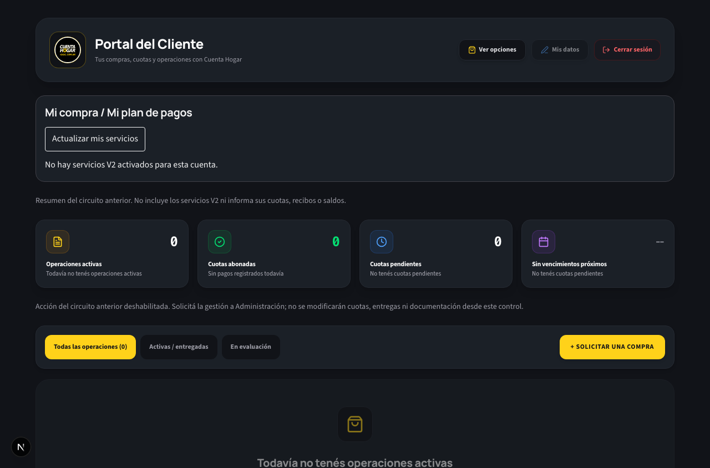
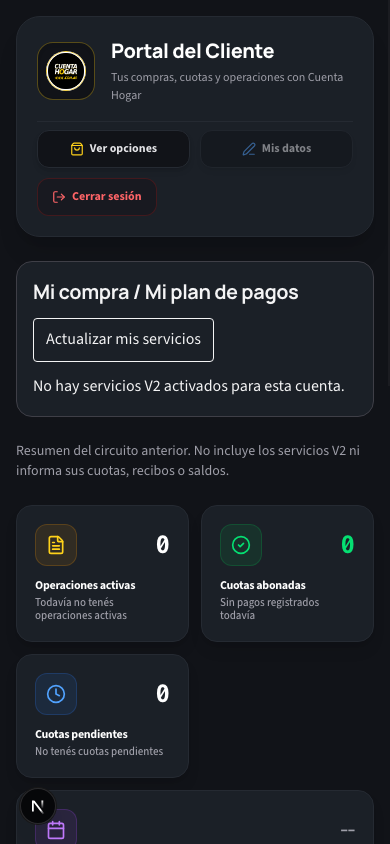

# Portal cliente: privacidad de borradores locales

## Cambio

`datosPreliminares` era una clave global sin UID. El portal recuperaba nombre, DNI, teléfono, domicilio y selección comercial sin verificar su propietario. No tiene escritores actuales en `src/`.

Se retira completamente su lectura y se elimina únicamente esa clave al montar/desmontar el portal. Si Storage no está disponible, nunca se recupera su contenido. No se introduce persistencia nueva. Se conserva el remount existente por UID, que limpia formulario, historial y componentes financieros al cerrar sesión o cambiar de cuenta.

No hay cambios en Firebase Auth, Rules, Firestore, documentos, cuotas o configuración productiva. El script local protegido queda fuera del commit.

## Validación

- TypeScript: PASS.
- Build: PASS.
- `npm run test:safe`: PASS, incluye guardas Auth.
- `node --import tsx scripts/testPublicSolicitudes.ts`: PASS (validación, doble envío, reintentos y compatibilidad).
- Browser con Next local + Auth/Firestore Emulator `demo-cuenta-hogar`: PASS en 1280×844 y 390×844.
- Casos: clave heredada, A→logout→B, recarga, cambio directo de UID, anónimo, conservación de otra clave, formulario público accesible y habilitado, cero conexiones Firebase externas y cero documentos comerciales creados.
- El envío público no se ejecuta en este runner para evitar su navegación posterior a WhatsApp; su validación/idempotencia se verifica en la suite pura.

## ESLint diferencial

Sin diagnósticos nuevos. El archivo histórico no tiene lint absoluto limpio: mantiene 8 errores y 15 advertencias anteriores (25 diagnósticos antes, 23 después). No se modificaron reglas ni se agregaron suppressions.

- `page.tsx:19` — @typescript-eslint/no-unused-vars: 'UserCheck' is defined but never used.
- `page.tsx:19` — @typescript-eslint/no-unused-vars: 'ShieldCheck' is defined but never used.
- `page.tsx:19` — @typescript-eslint/no-unused-vars: 'Link2' is defined but never used.
- `page.tsx:19` — @typescript-eslint/no-unused-vars: 'Upload' is defined but never used.
- `page.tsx:20` — @typescript-eslint/no-unused-vars: 'Phone' is defined but never used.
- `page.tsx:20` — @typescript-eslint/no-unused-vars: 'MapPin' is defined but never used.
- `page.tsx:20` — @typescript-eslint/no-unused-vars: 'Filter' is defined but never used.
- `page.tsx:20` — @typescript-eslint/no-unused-vars: 'FileCheck' is defined but never used.
- `page.tsx:30` — @typescript-eslint/no-explicit-any: Unexpected any. Specify a different type.
- `page.tsx:34` — @typescript-eslint/no-explicit-any: Unexpected any. Specify a different type.
- `page.tsx:39` — @typescript-eslint/no-explicit-any: Unexpected any. Specify a different type.
- `page.tsx:52` — @typescript-eslint/no-unused-vars: 'e' is defined but never used.
- `page.tsx:62` — @typescript-eslint/no-unused-vars: 'tieneUnlinked' is assigned a value but never used.
- `page.tsx:63` — @typescript-eslint/no-unused-vars: 'dniVincular' is assigned a value but never used.
- `page.tsx:63` — @typescript-eslint/no-unused-vars: 'setDniVincular' is assigned a value but never used.
- `page.tsx:64` — @typescript-eslint/no-unused-vars: 'vinculando' is assigned a value but never used.
- `page.tsx:64` — @typescript-eslint/no-unused-vars: 'setVinculando' is assigned a value but never used.
- `page.tsx:152` — react-hooks/exhaustive-deps: React Hook useEffect has missing dependencies: 'email' and 'fetchSolicitudes'. Either include them or remove the dependency array.
- `page.tsx:156` — @typescript-eslint/no-explicit-any: Unexpected any. Specify a different type.
- `page.tsx:227` — @typescript-eslint/no-explicit-any: Unexpected any. Specify a different type.
- `page.tsx:698` — @typescript-eslint/no-explicit-any: Unexpected any. Specify a different type.
- `page.tsx:704` — @typescript-eslint/no-explicit-any: Unexpected any. Specify a different type.
- `page.tsx:705` — @typescript-eslint/no-explicit-any: Unexpected any. Specify a different type.

## Reproducción

Con Java y los emuladores locales configurados, ejecutar `node --import tsx scripts/testClientLocalPrivacyBrowser.ts` bajo `firebase emulators:exec --project demo-cuenta-hogar --only auth,firestore`. Requiere GCLOUD_PROJECT/NEXT_PUBLIC_FIREBASE_PROJECT_ID=demo-cuenta-hogar, FIRESTORE_EMULATOR_HOST=127.0.0.1:8080, FIREBASE_AUTH_EMULATOR_HOST=127.0.0.1:9099 y ausencia de credenciales productivas. El runner rechaza otro proyecto, crea sólo dos usuarios Auth sintéticos y comprueba que Firestore permanece vacío. Usar Emulator limpio.

## Capturas

