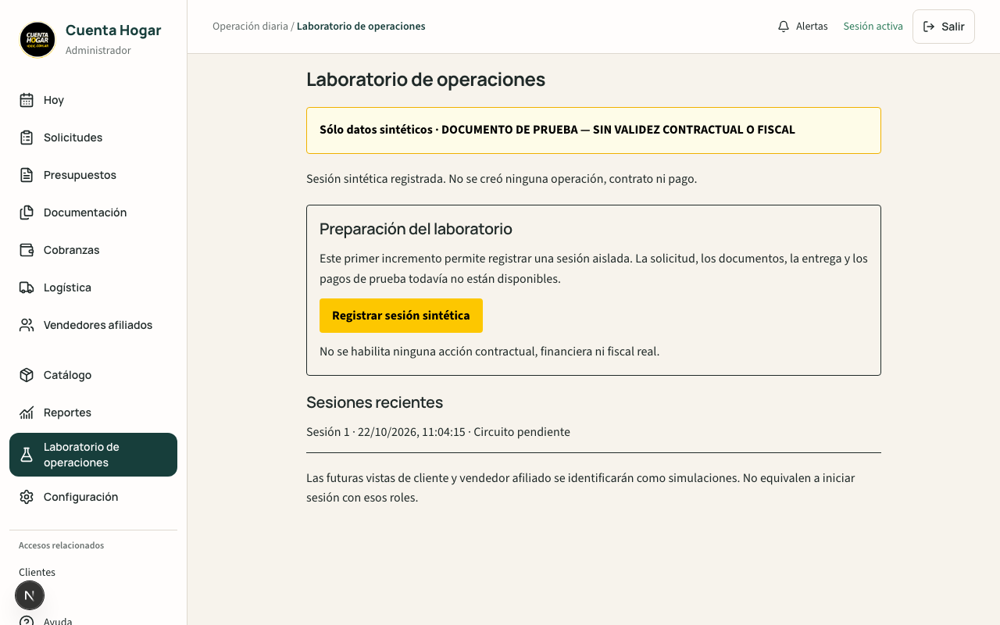
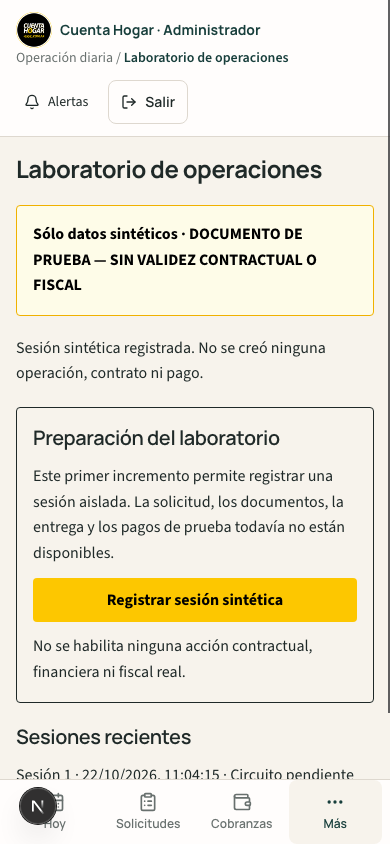

# Validación del incremento 1

Base: `474008785bed09e7a085ece138d814bfb876c2d7`. Pruebas locales con Node 24,
Next 16.2.1, Auth/Firestore/Storage Emulators y proyecto `demo-cuenta-hogar`.
No escrituras productivas, cambios Auth productivos ni despliegues.

| Comprobación | Resultado |
| --- | --- |
| TypeScript `npx tsc --noEmit` | PASS |
| ESLint de los siete archivos TS/TSX nuevos o modificados | PASS, sin diagnósticos |
| `npm run build` | PASS |
| `npm run test:safe` | PASS |
| `testOperationsLabEmulator.ts` | PASS |
| `testOperationsLabBrowser.ts`, desktop 1280×800 / mobile 390×844 | PASS |
| `testV2IntegralJourney.ts`, regresión del circuito existente | PASS |

La suite de laboratorio prueba ocho comandos concurrentes, replay sin cambio de updateTime
sobre los tres documentos, aislamiento por propietario, rechazo de campos extra e IDs inválidos,
conflicto con comando huérfano sin escrituras parciales, interruptor apagado, allowlist ausente o
inválida, anónimo, cuenta deshabilitada/no verificada, cuentas cliente y afiliado independientes,
denegación SDK incluso para admin y preservación de un registro sintético ajeno.

La suite integral existente recorrió solicitud, presupuesto, Acceptance, datos personales,
documentos, crédito, conformidad, READY, cliente recurrente, proveedor, custodia, tres firmas,
entrega sintética, activación, fiscal mock, pagos parciales/completos, reversas, permisos e integridad
histórica. Esto valida **regresión del circuito Emulator existente**, no su adaptación al laboratorio.
Los rechazos de preview de los escenarios negativos son esperados.

## Reproducción

Usar emuladores nuevos para cada suite (sin import/export de datos), proyecto exactamente
`demo-cuenta-hogar`, Firestore 8080, Auth 9099 y Storage 9199 con las Rules del checkout.
Imponer las variables de aislamiento de AGENTS.md, sin ADC ni credenciales productivas.

- Ejecutar `tsx scripts/testOperationsLabEmulator.ts` dentro de `firebase emulators:exec`.
- Para navegador, iniciar Next dev propio en localhost:3000 con configuración web demo,
  `NEXT_PUBLIC_E2E_TEST_MODE=1`, Auth Emulator y
  `OPERATIONS_LAB_ENABLED=true`, `OPERATIONS_LAB_ADMIN_UIDS=["synthetic-lab-browser"]`.
  Invocar la función exportada `testOperationsLabBrowser` desde tsx. La suite crea su propia
  cuenta Auth sintética verificada; no utiliza sesiones del propietario.
- La regresión integral `tsx scripts/testV2IntegralJourney.ts` inicia su servidor local.
- No ejecutar Next dev y build simultáneamente: comparten `.next`.

## Evidencias visuales

Sin desbordamientos; banner sintético visible, estados pendientes explícitos y sin acciones
contractuales o financieras habilitadas. El script local no versionado
`testBudgetV2HttpIdempotency.ts` se conserva fuera del PR, hash SHA-256
`09fb398ff9c634f7c5ca32a3769518dbde67d8ebca3f1f59a930ccdfe6340881`.

## Pendiente (no PASS)

Adaptación del circuito completo al espacio aislado desplegable, documentos de prueba,
finanzas y tres perfiles dentro del laboratorio. No se verificó ni habilitó su uso en la web pública.
El despliegue restrictivo de Rules y la configuración futura requieren revisión separada.
